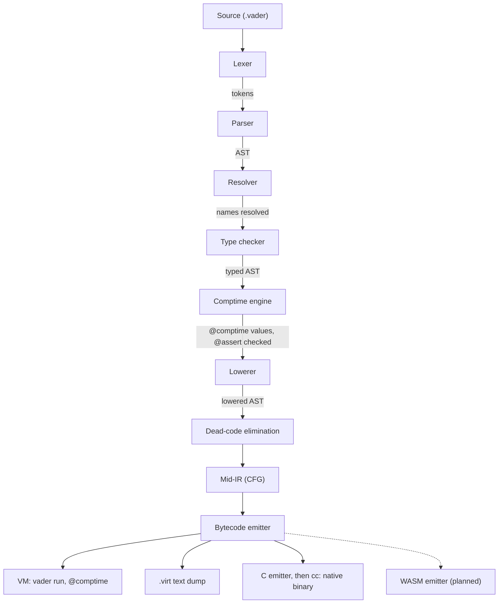

# Compiler architecture

How the Vader compiler turns source into a running program. The language itself is
described in [`SPEC.md`](../SPEC.md); this document covers the implementation and
may change without the language changing.

## Pipeline



| Stage | Directory | Output |
|---|---|---|
| Lexer | `vader/front/lexer/` | tokens |
| Parser | `vader/front/parser/` | AST, never mutated afterwards |
| Resolver | `vader/front/resolver/` | names bound to declarations, imports collected |
| Type checker | `vader/front/typecheck/` | types, narrowing, trait resolution |
| Comptime | `vader/front/comptime/` | `@comptime` values, generic struct instances |
| Lowerer | `vader/lower/` | lowered AST, generic instances materialised |
| Mid-IR | `vader/midir/` | CFG, DCE, escape analysis |
| Bytecode | `vader/bytecode/` | stack-based bytecode |
| VM | `vader/vm/` | runs the bytecode |
| C emitter | `vader/emit/c/` | one C file per module (`--split`) or one for the program |

Every stage can be dumped with `vader dump --stage=<name>`. The resolver is shared
with the LSP (`vader/tools/lsp/`) and the formatter (`vader/tools/fmt/`).

## Lexer: interpolated strings

The lexer emits a flat token stream for an interpolated string:

```
STRING_BEGIN  STRING_PART("foo ")  INTERP_OPEN  <expression tokens>  INTERP_CLOSE  STRING_PART(" bar")  STRING_END
```

`STRING_PART` carries decoded text. Between `INTERP_OPEN` and `INTERP_CLOSE` the
lexer emits ordinary tokens. A stack of modes (string or interpolation) handles
nesting. A raw string emits `STRING_BEGIN`, a single `STRING_PART` with its contents
as written, and `STRING_END` .

The lexer drops comments. Tools that need doc blocks re-scan the source.

## Canonical IR

The canonical IR is a stack-based bytecode. The VM runs it directly, the C emitter
translates it to C text, and it maps one to one to WebAssembly, which is also
stack-based.

## Comptime engine

`@comptime` values are evaluated by a tree-walking interpreter
(`vader/front/comptime/`) for the common case: expressions, and calls to functions
whose body is a single `return <expr>` or trailing expression. A declaration it
cannot evaluate (a loop, a statement body, local mutation) is compiled to bytecode
and run by the embedded VM (`vader/front/comptime/vm`). The result is converted back
to a comptime value.

A step budget stops loops that do not terminate. Running out of it, like any VM
trap, is reported as a comptime evaluation error (`C4002`). A shape neither engine
can evaluate is `C4001`.

The compiler's own tree must stay reproducible. `bootstrap/verify.sh` compares
stage1 and stage2 byte for byte on every pull request, so a `@comptime` value that
depends on the clock or the environment inside the compiler fails CI. The language
does not impose this rule on other programs.

## Monomorphization

The comptime pass records the generic struct instances the typed program names. The
lowerer materialises them, then discovers each generic function instance while it
lowers the bodies that call it, until no new instance appears. A recursion that
would grow its type argument forever is rejected before that (`T3104`).

After lowering, every `Struct<args>` names an emitted declaration and every generic
call names the instance that serves it. No later stage sees an unbound type
parameter.

### Instance flavors

Cloning every instance would multiply identical bodies: a `List<T>` used at ten
reference types would emit ten copies of the same pointer code. Each
`(declaration, type arguments)` instance gets one of three flavors instead. The
split depends on whether a type argument is a primitive value type or a reference
type.

- **Primitive value types**: the fixed-width integers, `f32`, `f64`, `bool`, `char`,
  `string`, an integer range, an enum, and a distinct type over any of these.
- **Reference types**: structs, arrays, tuples, closures. At run time they are all
  a uniform pointer.

| Flavor | When | Representation |
|---|---|---|
| **Mono** | a free function that dispatches a trait method on a type parameter, or returns a `T[]` | one body per instance, fully substituted (`second__i32`) |
| **Mixed** | at least one type argument is primitive | primitives stay concrete and unboxed (`Box<i64>` stores a raw `i64`); references are erased. One body per primitive shape (`Box__i64`, `Box__f32`) |
| **Erased** | every type argument is a reference type | every type parameter becomes the uniform pointer (`Any`). Identical erased instances share one body; a trait call dispatches at run time on the value's tag |

Since the split follows from the type arguments, no declaration needs an
annotation to be specialised.

The classifier is `fn_instance_flavor` in `vader/lower/mono_fn.vader`. Struct layout
and impl materialisation follow the same split in `vader/lower/mono_struct.vader`
and `vader/lower/subst.vader`.

## Lowered AST

The lowerer reads the typed AST and builds a separate, smaller AST of primitive
operations. The typed AST is never mutated.

- **`match`**: each arm becomes a guarded `if` on the pattern's discriminator (type
  tag, struct shape, literal equality) and its optional guard. The `match x :: e`
  binder becomes a local before the arms; struct patterns bind locals at the head of
  the arm. There is no decision-tree compilation.
- **String interpolation**: one string build, through the `std/core` byte-buffer
  API, or the shared `concat_N` when no segment is an integer or a `bool`. Other
  segments render through `Display.to_string`, called directly when the impl is
  known.
- **`defer`**: each body becomes a closure over the locals it captures (a captured
  local moves to a heap cell). The statement pushes it on the frame's defer stack
  (`defer.push`), and each block exit runs the closures registered since the block
  was entered, last in first out (`defer.pop_exec N`). In an async coroutine the
  stack lives in the coroutine frame and survives a suspension.
- **Trait calls**: a call on a receiver of concrete type calls that type's impl
  member directly. A call on a trait-typed value, or on the receiver of an erased
  instance, goes through a vtable (`virtual.call`) filled with the impl members that
  take `self`.
- **Bounds checks**: a release build drops the array index checks that range
  analysis proves useless.

## Dead-code elimination

Between the lowerer and the CFG, DCE drops the functions that are not reachable from
the roots. Structs and constants are kept. The roots are `main`, every function
with `@export` or `@extern` or without a body, the `@test` functions in a test build,
and every function of the entry module when the program has no `main`. A call
through a vtable keeps every impl member that can fill that slot.

## Mid-IR (CFG)

Each lowered function becomes a reducible CFG of basic blocks ending in `branch`,
`cond_branch`, `return` or `unreachable`. Expressions become three-address
instructions over named local slots. Strings go into a project-wide pool that the
emitter reuses.

The CFG supports the analyses that need def-use chains:

- **escape analysis**: structs that do not outlive their function are allocated on
  the stack;
- **loop-carried dependencies**: replaces the old rule that anything in a loop
  escapes;
- **dead-store elimination**: removes individual writes whose value is never read.

The bytecode emitter reads the CFG and recovers structured nesting, placing each
block once by dominator tree ([ADR 0027](adr/0027-the-structurer-places-each-block-once-by-dominator-tree.md)).
The design is in [`MID_IR_DESIGN.md`](MID_IR_DESIGN.md).

## Intrinsics

A function without a body must carry `@intrinsic` or `@extern` (`T3062`). At
bytecode emission, the compiler checks that every host import other than `@extern`
is wired: its mangled name is known to the intrinsic manifest (`intrinsic_id_for` in
`vader/core/bytecode/intrinsic_manifest.vader`) or maps to a dedicated op. The VM and
the C backend each match on the manifest exhaustively, so a new intrinsic must be
handled by both. An unwired host fails the build instead of reaching run time as an
unbound `call.import`.

`@intrinsic` on an impl (`string implements Hash`) makes the compiler create one
bodiless function per trait method, mangled `<module>$<type>$<trait>$<method>`.

Some intrinsic impl methods are op-level: the bytecode emitter recognises the
mangled name (`std_core$i32$Add$add`) and emits a dedicated op (`i32.add`), so
`a + b` and `a.add(b)` take the same path.

## Self-hosting and bootstrap

The compiler is written in Vader and compiles itself. Every stage of the native
pipeline is self-hosted; only the WebAssembly emitter does not exist yet.

The compiler is at a fixed point: built by itself, it emits the same C as the
compiler that built it, byte for byte. A committed C seed (`bootstrap/seed/`) rebuilds
the toolchain on any machine with a C compiler (`bootstrap/build.sh`). CI checks the
fixed point from the seed on every push to `main` and every pull request
(`bootstrap/verify.sh`). The native CLI is the only compiler, and the snapshot tests
use it as the oracle for every stage. Details: [`BOOTSTRAP.md`](BOOTSTRAP.md).
