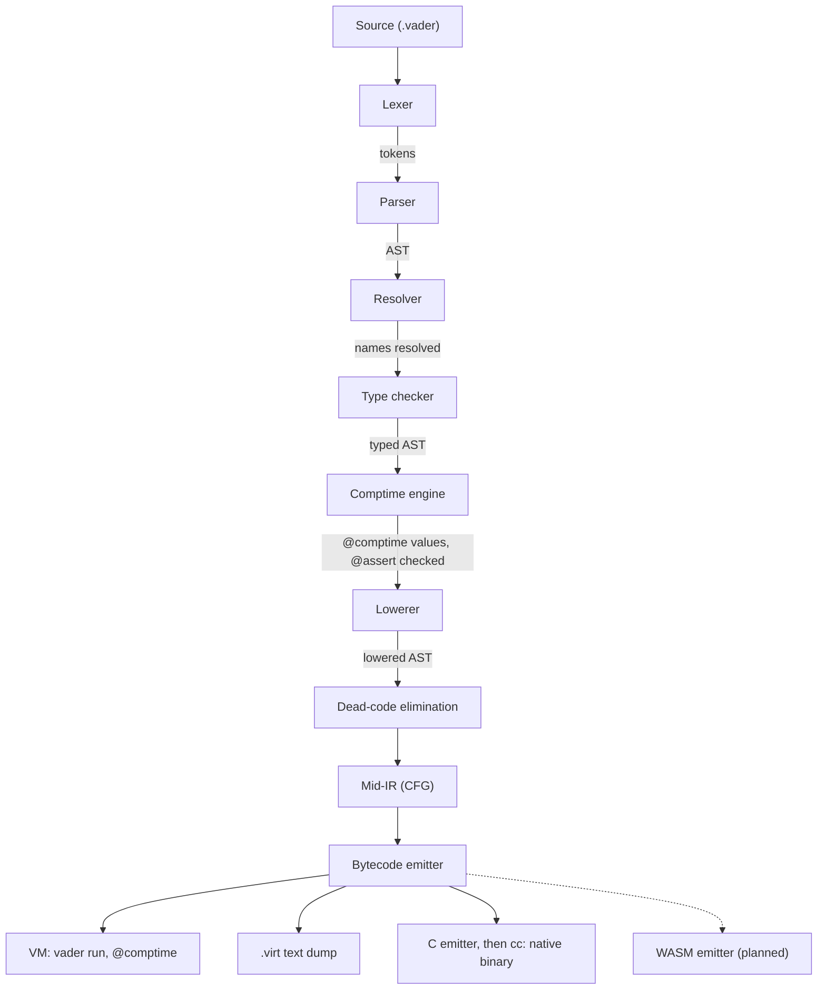

# Compiler architecture

How the Vader compiler turns source into a running program. The language is in
[`SPEC.md`](../SPEC.md); this document covers the implementation, which may change
without the language changing.

## Pipeline



| Stage | Directory | Output |
|---|---|---|
| Lexer | `vader/front/lexer/` | tokens |
| Parser | `vader/front/parser/` | AST |
| Resolver | `vader/front/resolver/` | names bound to declarations, imports collected |
| Type checker | `vader/front/typecheck/` | types, narrowing, trait resolution |
| Comptime | `vader/front/comptime/`, `vader/pipeline/comptime_vm/` | `@comptime` values |
| Lowerer | `vader/lower/` | lowered AST (`vader/lower/ir/`), generic instances materialised |
| Dead-code elimination | `vader/lower/dce/` | unreachable functions removed |
| Mid-IR | `vader/midir/` | CFG, escape analysis, range analysis |
| Bytecode emitter | `vader/emit/bytecode/` | stack-based bytecode (format: `vader/core/bytecode/`) |
| `.virt` text | `vader/emit/virt/`, `vader/front/virt/` | the bytecode written as text, and read back |
| VM | `vader/vm/` | runs the bytecode |
| C emitter | `vader/emit/c/` | one C file per module, or one under `--no-split` |

The stack-based bytecode is the canonical IR: the VM runs it, the C emitter
translates it, and it maps one to one to WebAssembly. [`RUNTIME.md`](RUNTIME.md)
describes the values and memory of a running program.

`vader dump --stage=<name>` prints any stage; `vader run` and `vader build` accept
a `.virt` file, the whole program after monomorphization without source
positions. The LSP (`vader/tools/lsp/`) and the formatter (`vader/tools/fmt/`)
share the resolver; `vader/support/diagnostics/codes.vader` holds every phase's
diagnostic codes.

Before the type checker, the loader keeps one body per `@target` group
(`vader/front/resolver/target_select.vader`), so a body for another target is never
type-checked, and the resolver fills each impl from its trait
(`vader/front/resolver/impl_members.vader`): the method a short impl stands for,
plus a declaration of each default method it inherits, its signature read with
`Self` and the trait's parameters substituted. The default body itself stays in
the trait: the type checker checks it once there, `Self` a type parameter bounded
by the trait, and the lowerer reads it for each impl as it reads a generic
function for each instance (`vader/lower/inherited.vader`).

A project's `build.vader` drives the same pipeline through `toolchain/build`
(`lib/toolchain/build/drive.vader`): per generation round the front end runs once,
the driver reads each module's typed declarations and phase boundaries from that
run, which the back end lowers.

## Lexer: interpolated strings

The lexer emits a flat token stream for an interpolated string:

```
STRING_BEGIN  STRING_PART("foo ")  INTERP_OPEN  <expression tokens>  INTERP_CLOSE  STRING_PART(" bar")  STRING_END
```

`STRING_PART` carries decoded text, ordinary tokens come between `INTERP_OPEN` and
`INTERP_CLOSE`, and a stack of string and interpolation modes handles nesting. A
raw string is `STRING_BEGIN`, one `STRING_PART` as written, and `STRING_END`.

The lexer drops comments. Asked for docs (`tokenize_with_docs`), it also keeps each
run of `///` lines beside the tokens, never in the stream, and the parser gives a run
to the declaration, field, variant or member whose first token follows it
(`parse_source_with_docs`, the `doc` field of `toolchain/ast`). A build parses without
docs. The formatter and semantic tokens re-scan the source for every comment.

## Comptime engine

A tree-walking interpreter (`vader/front/comptime/`) evaluates expressions and calls
to functions whose body is a single `return <expr>` or trailing expression. A
declaration it cannot evaluate (a loop, a statement body, local mutation) runs as
bytecode on the embedded VM (`vader/pipeline/comptime_vm`), and its result becomes
a comptime value. The interpreter decides nothing the type checker settled: a call
runs the function recorded at the site (`call_sites`), `&&` and `||` evaluate their
right operand only when the left one leaves the result open, and what it would
evaluate otherwise than the run time goes to the VM (a generic call, an operator a
type implements, the `Display` of an array or a struct).

A constant whose value reads itself through a function it calls recurses on the
VM until its call stack overflows: the driver finds, in the stack the VM returns
with the overflow, the function of a pending constant running again below itself,
and reports the cycle
([ADR 0118](adr/0118-a-comptime-cycle-through-a-function-is-found-at-the-overflow.md)).

The parser wraps every `@comptime` value other than a call without arguments in a
function without parameters, which the constant calls: the comptime VM runs such
calls.

It also folds the constants without `@comptime` it can evaluate, for the lowerer to
inline their scalar uses; the others reach the lowerer as written, without error.

A step budget stops a loop that does not terminate; running out of it is, like any
VM trap, a comptime evaluation error.

The compiler's own tree, unlike other programs, must keep its `@comptime` values
free of the clock and the environment, or the fixed-point check fails
(*Self-hosting and bootstrap*).

## Monomorphization

The lowerer discovers each instance while lowering the code that needs it: a
generic function instance at its call, a generic struct instance where a literal
builds it or a call reaches one of its impl members. Lowering an instance can
discover others, until no new one appears; code never lowered asks for none. The
type checker has already rejected a recursion whose type argument would grow
forever (`vader/front/typecheck/growing_recursion.vader`).

After lowering, every `Struct<args>` names an emitted declaration and every generic
call its instance: no later stage sees an unbound type parameter.

### Instance flavors

So that identical bodies are emitted once, each `(declaration, type arguments)`
instance gets one of three flavors, by whether its type arguments are primitive
value types or reference types:

- **Primitive value types**: the fixed-width integers, `f32`, `f64`, `bool`, `char`,
  `string`, an integer range, an enum, and a distinct type over any of these.
- **Reference types**: structs, arrays, tuples, closures, all a uniform pointer at
  run time.

| Flavor | When | Representation |
|---|---|---|
| **Mono** | a free function whose code depends on the concrete type of a type parameter | one fully substituted body per instance (`second__i32`) |
| **Mixed** | at least one type argument is primitive | primitives stay concrete and unboxed (`Box<i64>` stores a raw `i64`), references are erased; one body per primitive shape (`Box__i64`, `Box__f32`) |
| **Erased** | every type argument is a reference type | every type parameter becomes the uniform pointer (`Any`); identical instances share one body, and a trait call dispatches on the value's tag |

The erased instances of a generic struct share one body and one tag: nothing in a
value tells `Box<Foo>` from `Box<Bar>`, and the type checker refuses a type test,
or an `==` on a union, that would need to.

The classifier is `fn_instance_flavor` (`vader/lower/mono_fn.vader`); struct layout
and impl materialisation follow the same split (`vader/lower/mono_struct.vader`,
`vader/lower/subst.vader`).

## Lowered AST

The lowerer builds, from the typed AST it never mutates, a separate, smaller AST of
primitive operations (`vader/lower/ir/`) that later stages read without the
lowerer; `vader/lower/optimise/` holds its rewrites of that output,
`vader/lower/dump/` the `vader dump --stage=lowered-ast` text.

The lowerer does not choose a callee again: it follows the type checker's record of
each call site's callee, operators and indexing included, and of each `Into`
conversion (`vader/front/typecheck/call_sites.vader`,
`vader/lower/recorded_callee.vader`), inserting the `into()` calls. Only a site the
record leaves open (a call through a fn value, a member settled per instance) takes
the lowerer's own route.

- **`match`**: each arm becomes a guarded `if` on the pattern's discriminator (type
  tag, struct shape, literal equality) and its optional guard. There is no
  decision-tree compilation.
- **String interpolation**: one string build through the `std/core` byte-buffer
  API; a segment other than a string, an integer or a `bool` renders through
  `Display.to_string`.
- **`defer`**: each body becomes a closure over its captured locals, pushed on the
  defer stack (`defer.push`); each block exit runs, last in first out, the
  closures registered since its entry (`defer.pop_exec N`). The stack:
  [`RUNTIME.md`](RUNTIME.md) *Traps and defer*.
- **Trait calls**: a call on a receiver of concrete type calls that type's impl
  member; one on a trait-typed value, or on an erased instance's receiver, goes
  through a vtable (`virtual.call`) of the impl members that take `self`.
- **Operators**: an operator on a non-primitive type calls its trait member
  (`a < b` becomes `compare(a, b) < 0`). `==` on a tuple or a union, which have no
  `Equals` impl, compares part by part (`vader/lower/value_eq.vader`).
- **`for`**: a fused chain, a range written in place or an array becomes a plain
  loop (`vader/lower/for_in.vader`); any other loop calls `next()` until it
  returns `Stop`, after the recorded `into()` for a value that only converts into
  an iterator. The step's shape lives in `vader/lower/iterator_step.vader`
  ([ADR 0120](adr/0120-an-iterator-step-returns-its-element-or-stop.md)).
- **Iterator fusion**: a `for` over a chain of generator calls
  (`(0..<n).map(f).filter(p)`) becomes one loop, with no iterator object and no
  intermediate array (`vader/lower/iter_fusion.vader`). A generator's role comes
  from the shape of its body, never from its name: one whose loops iterate its
  source parameter is a layer over the source beneath it, any other a source. A
  function that drains an `Iterator<T>` parameter with one `for`, a user function
  as much as `collect`, is inlined where its argument fuses. A chain stored,
  returned or passed to a function not inlined runs as real iterators.
- **Generators and `async`**: each becomes a state machine
  (`vader/lower/coroutine.vader`): the function returns a fresh struct holding its
  parameters, its locals and the state to resume at, which `Iterator.next`
  (`vader/lower/generator.vader`) or `Async.resume` (`vader/lower/async.vader`)
  resumes.
- **Module constants**: `vader/lower/inline_consts.vader` gives each its storage
  ([`RUNTIME.md`](RUNTIME.md) *Globals and constants*); the lowering the comptime
  VM runs guards none, since that VM refuses global slots
  ([ADR 0119](adr/0119-a-constant-read-while-its-value-is-computed-stops-the-program.md)).
- **Reflection**: the reflection intrinsics (`@size_of`, `@type_name`, ...) fold to
  literals on a type known at lowering (in a generic body, the instance's types),
  and `@fields(T)` to an array literal of `Field` (`vader/lower/intrinsic.vader`).
  `@comptime for` unrolls over an array literal, one copy of the body per element.

## Dead-code elimination

DCE drops the functions unreachable from the roots, keeping structs and constants.
The roots are `main`, every function with `@export` or `@extern` or without a body,
the `@test` functions in a test build, and every function of the entry module when
the program has no `main`. An impl member is no root: a call through a vtable keeps
the members that fill that slot for a struct reachable code holds a value of (one a
literal builds, a call returns, a constant holds or a root receives), and a receiver
that is not a struct always counts. The vtable keeps the entries whose function
survives.

## Mid-IR (CFG)

Each lowered function becomes a reducible CFG of basic blocks over typed locals
([`MID_IR.md`](MID_IR.md) describes it as a language). `vader/midir/` holds the
CFG, its construction, its verifier and the call graph; its passes, sub-modules
importing it, run in this order, and `vader build --verify` checks the CFG after
each:

1. `value_return/`: a function returning a small tuple, or an `S | null` built at
   every `return`, hands back the elements as separate values;
2. `optimise/`: folds moves and drops the locals nothing reads, but not an
   instruction with an effect or one that may stop the program
   ([ADR 0117](adr/0117-a-run-time-check-runs-whether-or-not-its-value-is-read.md));
3. `optimise/`, escape analysis: in a native build, a struct that cannot outlive its
   function is placed on the stack;
4. `optimise/`: a repeated read of an array element within a block becomes a copy;
5. `ranges/`, range analysis: tracks integer intervals and array lengths and, in a
   release native build, marks the index checks it proves useless for the C emitter
   to drop.

`vader/midir/pipeline/` runs them on every path that emits bytecode; the comptime
VM skips `value_return/`. Below the passes, `select/` maps types to bytecode value
types and operations to ops.

The bytecode emitter recovers structured nesting from the CFG, placing each block
once by dominator tree ([ADR 0027](adr/0027-the-structurer-places-each-block-once-by-dominator-tree.md)).

## Intrinsics

A function without a body is an `@intrinsic` or an `@extern` (SPEC §12). Bytecode
emission fails the build on a host import, other than an `@extern`, whose mangled
name is neither in the intrinsic manifest
(`vader/core/bytecode/intrinsic_manifest.vader`) nor mapped to a dedicated op, so
no unbound `call.import` reaches run time. The VM and the C backend each match on
the manifest exhaustively: both must handle a new intrinsic.

`@intrinsic` on an impl (`string implements Hash`) makes the resolver create one
bodiless function per trait method, mangled `<module>$<type>$<trait>$<method>`.
For some, the bytecode emitter recognises that name (`std_core$i32$Add$add`) and
emits a dedicated op (`i32.add`), so `a + b` and `a.add(b)` take the same path.

## Foreign calls

An `@extern` declaration becomes a host import of the bytecode, which each backend
binds its own way.

**Native build.** For each `@extern`, the C emitter writes a shim,
`vader_host_<mangled>` (`vader/emit/c/host.vader`), reached by the import's
`call.import`. It converts the values from the representations of
[`RUNTIME.md`](RUNTIME.md) to what SPEC §13 *Allowed signature types* says crosses,
and calls the foreign symbol, declared by the header that `@c_header` or the
`CLibrary` names, else by an `extern` synthesised from the Vader signature. A
`@c_struct` mirror is copied field by field, by name, into a real C struct, so `cc`
takes every offset from the header.

`_Static_assert` lines in the generated C pin each mirrored field's width, offset
and, for an integer, signedness to the C field of that name, and each `@c_type` to
an integer as wide as the Vader one: `cc` checks what the declarations assume of
the headers, at no run-time cost.

A named function passed as a callback reaches C as its own symbol (`fn.addr`).
Each `CLibrary`'s shims go in their own C unit, with that library's headers only,
so two libraries whose headers declare the same names bind in one program.

**`vader run`.** The VM calls an `@extern` dynamically (`runtime/c/vader_ffi.h`),
opening the library, looking the symbol up and calling it through a trampoline per
signature shape. It reads no header: a mirror lent by address is laid out from its
Vader fields at natural alignment (`vader/core/bytecode/c_layout.vader`), which the
native asserts check against C. A call no trampoline covers
(`vader/vm/adapters.vader`) goes through a C adapter
(`vader/emit/c/adapters.vader`), compiled by `cc` with the same asserts before the
program starts (`vader/pipeline/ffi_adapters.vader`). An import taking a callback
is never adapted: the VM traps on its `fn.addr` first.

## Self-hosting and bootstrap

The compiler is written in Vader and compiles itself, every stage of the native
pipeline included; only the WebAssembly emitter does not exist yet.

It is at a fixed point: built by itself, it emits the same C as the compiler that
built it, byte for byte. Its output must depend on the sources' content alone:
since symbol ids are minted in file order, the loader reads a module's files
sorted by name, a generated file last (`vader/front/resolver/lazy.vader`).
[`BOOTSTRAP.md`](BOOTSTRAP.md) describes the C seed that rebuilds the toolchain and
the CI check of the fixed point. The native CLI is the only compiler, and the
snapshot tests' oracle for every stage.
