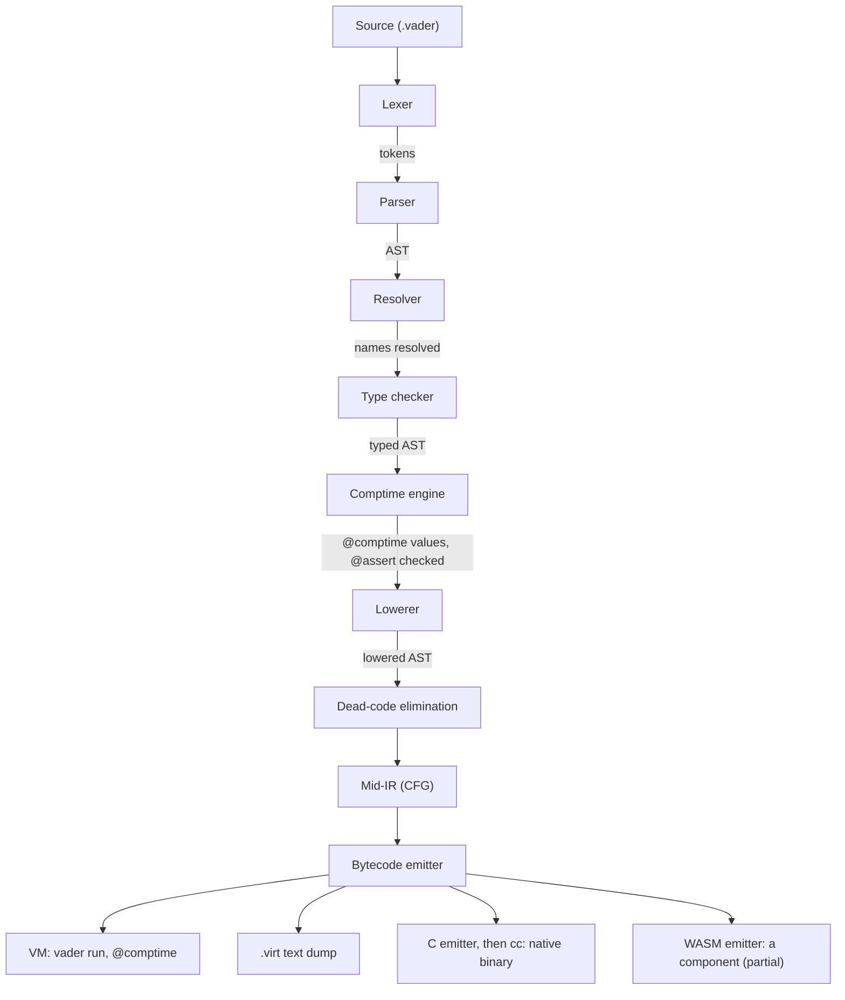

# Compiler architecture

How the Vader compiler turns source into a running program. The language is in
[`SPEC.md`](../SPEC.md); this document covers the implementation, which may change
without the language changing.

## Pipeline



| Stage | Directory | Output |
|---|---|---|
| Lexer | `lib/toolchain/lexer/` | tokens |
| Parser | `lib/toolchain/parser/` | AST |
| Resolver | `vader/front/resolver/` | names bound to declarations, imports collected |
| Type checker | `vader/front/typecheck/` | types, narrowing, trait resolution |
| Comptime | `vader/front/comptime/`, `vader/pipeline/comptime_vm/` | `@comptime` values |
| Lowerer | `vader/lower/` | lowered AST (`vader/lower/ir/`), generic instances materialised |
| Dead-code elimination | `vader/lower/dce/` | unreachable functions removed |
| Mid-IR | `vader/midir/` | CFG, escape analysis, range analysis |
| Bytecode emitter | `vader/emit/bytecode/` | stack-based bytecode (format: `vader/core/bytecode/`) |
| `.virt` text | `vader/emit/virt/`, `vader/front/virt/` | the bytecode written as text, and read back |
| VM | `vader/vm/` | runs the bytecode |
| C emitter | `vader/emit/c/` | one C file per module, or one under `--no-split` |

The stack-based bytecode is the canonical IR: the VM runs it, the C emitter
translates it, and it maps one to one to WebAssembly. [`RUNTIME.md`](RUNTIME.md)
describes the values and memory of a running program.

`vader dump --stage=<name>` prints any stage; `vader run` and `vader build` accept
a `.virt` file, the whole program after monomorphization without source
positions. The LSP (`vader/tools/lsp/`) and the formatter (`vader/tools/fmt/`)
share the resolver; `lib/toolchain/diagnostics/codes.vader` holds every phase's
diagnostic codes. The lexer, the parser and the diagnostics sit in `lib/toolchain/`
next to the syntax tree and import nothing from `vader/`: a program can parse Vader
without carrying the compiler, which a build driver is meant to do (ADR 0145).

Before the type checker, the loader keeps one body per `@target` group
(`vader/front/resolver/target_select.vader`), so a body for another target is never
type-checked, and the resolver fills each impl from its trait
(`vader/front/resolver/impl_members.vader`): the method a short impl stands for,
plus a declaration of each default method it inherits, its signature read with
`Self` and the trait's parameters substituted. The default body itself stays in
the trait: the type checker checks it once there, `Self` a type parameter bounded
by the trait, and the lowerer reads it for each impl as it reads a generic
function for each instance (`vader/lower/inherited.vader`).

Once every module is parsed, and before any is collected, the loader runs the
source stages (`vader/front/resolver/source_stages.vader`, the `Stage` of
`toolchain/stage` at that point): each reads the files of a module that declare
something under a decorator it names, and writes source the module gains as a
file of its own, parsed like the others (`@displayable` is the first). A module
is parsed without its tests, and the private declarations only they reach, unless
the load runs them (`vader/front/resolver/dependency_tests.vader`); in the module
under test, the stage of `@test` writes `tests$$run`, which calls each test by its
rank (`vader/front/resolver/tests_stage.vader`), and `vader test` runs that entry
once per test. A test is then reached from it, as any function is from its
callers: no later pass knows what a test is. The stages a
project's driver plugs run in the driver's process: the build server plans a
stand-in for each beside the compiler's (`vader/build_server/stages.vader`), which
sends the driver the files and waits for its text, and registers them for the
project (`register_project_stages`) so that every load of it plans them. Each
answer is recorded under `build/stages/` with a key of the files the stage read,
named from the project folder as the driver reads them (`driver_names`), so that a
command naming a file otherwise replays the same record; a
load with no driver (`vader run`, `vader test`, the language server) replays the
records (`vader/front/resolver/stage_records.vader`), warning on a key that no
longer matches. A function a stage writes without a body, top-level or impl member
(`parse_stage_written` lets a member go bare), waits for the body stage of the same
name (`LateFn`): the type checker reads its signature and leaves it be. Once the
module bodies are typed, `check_project` evaluates the comptime, delivers the
decorator values to each body stage, parses the body it gives, resolves it in the
scope of its declaration's file (`vader/front/resolver/late_body.vader`) and types
it (`check_late_body`), before the effect summary and the checks
(`vader/pipeline/check/late_bodies.vader`). A body stage of the driver has its
stand-in too (`DriverBodyStage`, one `BodyStageFrame` per function), planned with
the source stages (`StagePlan`), and its answer is recorded under
`build/stages/<stage>/<module>.bodies/`, keyed by the declarations it read; a load
with no driver replays it (`ReplayedBodyStage`). A comptime call to such a function is
an error whether its body is there yet or not, so the two evaluations of the
project agree. It then
wraps each function an interceptor marks (`vader/front/resolver/intercept.vader`).
The shape of the function an interceptor names in `around` is read from its
declaration first (`around.vader`): a wrong one is reported in the user's code,
and no glue is written for it. The function is renamed, and the module gains a
file of glue beside the file of the function, opening with its imports: a wrapper
under the function's name, which calls `around`, and one `@singleton` holding its
state and its `Site`, whose decorator value `@decorator` reads once the comptime
pass has computed it (the typecheck records which decorator a call reads,
`decorator_reads`, and the lowerer builds the value as a literal). The glue is
written as source and parsed (`parse_compiler_written`), under names no user can
write: `g$$intercepted`, `g$$layer` (`generated_name` in `vader/core/mangle`, ADR
0157). Each interceptor of a function adds one such layer, the first written
outermost: the layers under the first are `g$$proceed2`, `g$$proceed3`... each with
its numbered singleton. A walk over the declarations of a written file never meets
it. A build writes each such file under `build/expanded/` (`write_expanded` in
`vader/pipeline/layout.vader`) and points the diagnostics in it there; the file
keeps its `<generated>:` name inside the compiler. Each such file records the code
a user wrote that asked for each of its parts (`SourceFile.origins`), and
`link_generated_origins` adds it to a diagnostic found in the part
(`Diagnostic.related`).
The decorator is matched to its declaration from the parsed files alone
(`decorator_origin.vader`), the way the resolver later finds it. Every module is
collected only then, in the order the modules were read, so symbol ids do not
depend on what the stages and interceptors write. Code the compiler writes is
parsed under a file name no file on disk has (`generated.vader`), which a warning
about written code leaves alone.

A project's `build.vader` drives the same pipeline through `toolchain/build`, and
`vader` runs it (`vader/build_server`, ADR 0145): per generation round the front end
runs once, the driver reads the typed declarations of the project's modules (those
of origin `Build`, never the library's) and the phase boundaries from that run,
which the back end lowers. The driver is a process of its own,
compiled from `lib/` alone: `vader` starts it (`vader/tools/cli/driver_process.vader`)
and the two talk in the frames of `toolchain/protocol` over the driver's standard
streams, the driver's stdout also carrying what the project prints. The
declarations cross as written, but for the bodies of their functions
(`declarations.vader`, ADR 0150). The driver opens with its configuration and what it did before pulling
the stream; between two events, what it did since (modules to generate, reports)
reaches the build, which writes the generated modules at `BeforeEmit`. A question
of the driver, the vaderdoc of a node named by its span, is answered at once from
the files the build delivered, which a driven build loads with their vaderdoc
(`vader/build_server/questions.vader`, ADR 0149). Once the
driver had its say on the end, the build prints what it holds, and still takes what
the driver reports or emits until the driver's exit stops it, which prints the
rest: a module emitted then is one no round writes. A `vader.json` is served by the
same build, its driver standing in `vader` itself (`manifest_peer`).

## Lexer: interpolated strings

The lexer emits a flat token stream for an interpolated string:

```
STRING_BEGIN  STRING_PART("foo ")  INTERPOLATION_OPEN  <expression tokens>  INTERPOLATION_CLOSE  STRING_PART(" bar")  STRING_END
```

`STRING_PART` carries decoded text, ordinary tokens come between
`INTERPOLATION_OPEN` and `INTERPOLATION_CLOSE`, and a stack of string and
interpolation modes handles nesting. A raw string is `STRING_BEGIN`, one
`STRING_PART` as written, and `STRING_END`.

The lexer drops comments. Asked for docs (`tokenize_with_docs`), it also keeps each
run of `///` lines beside the tokens, never in the stream, and the parser gives a run
to the declaration, field, variant or member whose first token follows it
(`parse_source_with_docs`, the `doc` field of `toolchain/ast`). The same lexing keeps
the span of every comment but those inside the `${...}` of a string literal, which
the formatter, the semantic tokens and `vader doc` read. A build parses without
either.

## The task check

The rules of SPEC §16 *Values shared between tasks* are checked after typing, over
the effect summary of every function (`vader/front/effects/`): what it assigns,
grows, keeps or hands back of what it is lent, path by path under each parameter.

- The gates are the primitives of `std/task`, each saying what it is to a task
  with `@task_primitive`, a decorator private to `std/task`
  (`vader/front/effects/task_primitives.vader`): the parameters and fields it names
  are checked, a wrong one stops the compiler. A function that only forwards to a
  member of `Intrinsic` that parks (`intrinsic_parks`) is a gate too. The
  synchronised types carry `@task_shared`.
- A function that hands one of its parameters to a task is a gate for its
  callers: a fixed point over the call graph (`vader/front/effects/tasks.vader`).
- For each value at a gate, the check crosses what the task touches with what the
  launcher touches until the `join` that ends the task
  (`vader/front/effects/task_shape.vader`), and reports a conflict naming both
  sides (`vader/front/effects/task_errors.vader`).

## Comptime engine

A tree-walking interpreter (`vader/front/comptime/`) evaluates expressions and calls
to functions whose body is a single `return <expr>` or trailing expression. A
declaration it cannot evaluate (a loop, a statement body, local mutation) runs as
bytecode on the embedded VM (`vader/pipeline/comptime_vm`), and its result becomes
a comptime value. The interpreter decides nothing the type checker settled: a call
runs the function recorded at the site (`call_sites`), `&&` and `||` evaluate their
right operand only when the left one leaves the result open, and what it would
evaluate otherwise than the run time goes to the VM (a generic call, an operator a
type implements, the `Display` of an array or a struct).

A constant whose value reads itself through a function it calls recurses on the
VM until its call stack overflows: the driver finds, in the stack the VM returns
with the overflow, the function of a pending constant running again below itself,
and reports the cycle
([ADR 0118](adr/0118-a-comptime-cycle-through-a-function-is-found-at-the-overflow.md)).

The parser wraps every `@comptime` value other than a call without arguments in a
function without parameters, which the constant calls: the comptime VM runs such
calls.

It also folds the constants without `@comptime` it can evaluate, for the lowerer to
inline their scalar uses; the others reach the lowerer as written, without error.

A step budget stops a loop that does not terminate; running out of it is, like any
VM trap, a comptime evaluation error.

The compiler's own tree, unlike other programs, must keep its `@comptime` values
free of the clock and the environment, or the fixed-point check fails
(*Self-hosting and bootstrap*).

## Monomorphization

The lowerer discovers each instance while lowering the code that needs it: a
generic function instance at its call, a generic struct instance where a literal
builds it or a call reaches one of its impl members. Lowering an instance can
discover others, until no new one appears; code never lowered asks for none. The
type checker has already rejected a recursion whose type argument would grow
forever (`vader/front/typecheck/growing_recursion.vader`).

After lowering, every `Struct<args>` names an emitted declaration and every generic
call its instance: no later stage sees an unbound type parameter.

### Instance flavors

So that identical bodies are emitted once, each `(declaration, type arguments)`
instance gets one of three flavors, by whether its type arguments are primitive
value types or reference types:

- **Primitive value types**: the fixed-width integers, `f32`, `f64`, `bool`, `char`,
  `string`, an integer range, an enum, and a distinct type over any of these.
- **Reference types**: structs, arrays, tuples, closures, all a uniform pointer at
  run time.

| Flavor | When | Representation |
|---|---|---|
| **Mono** | a free function whose code depends on the concrete type of a type parameter | one fully substituted body per instance (`second__i32`) |
| **Mixed** | at least one type argument is primitive | primitives stay concrete and unboxed (`Box<i64>` stores a raw `i64`), references are erased; one body per primitive shape (`Box__i64`, `Box__f32`) |
| **Erased** | every type argument is a reference type | every type parameter becomes the uniform pointer (`Any`); identical instances share one body, and a trait call dispatches on the value's tag |

The erased instances of a generic struct share one body and one tag: nothing in a
value tells `Box<Foo>` from `Box<Bar>`, and the type checker refuses a type test,
or an `==` on a union, that would need to.

The classifier is `fn_instance_flavor` (`vader/lower/mono_fn.vader`); struct layout
and impl materialisation follow the same split (`vader/lower/mono_struct.vader`,
`vader/lower/subst.vader`).

## Lowered AST

The lowerer builds, from the typed AST it never mutates, a separate, smaller AST of
primitive operations (`vader/lower/ir/`) that later stages read without the
lowerer; `vader/lower/optimise/` holds its rewrites of that output,
`vader/lower/dump/` the `vader dump --stage=lowered-ast` text.

The lowerer does not choose a callee again: it follows the type checker's record of
each call site's callee, operators and indexing included, and of each `Into`
conversion (`vader/front/typecheck/call_sites.vader`,
`vader/lower/recorded_callee.vader`), inserting the `into()` calls. Only a site the
record leaves open (a call through a fn value, a member settled per instance) takes
the lowerer's own route.

- **`match`**: each arm becomes a guarded `if` on the pattern's discriminator (type
  tag, struct shape, literal equality) and its optional guard. There is no
  decision-tree compilation.
- **String interpolation**: one string build through the `std/core` byte-buffer
  API; a segment other than a string, an integer or a `bool` renders through
  `Display.to_string`.
- **`defer`**: each body becomes a closure over its captured locals, pushed on the
  defer stack (`defer.push`); each block exit runs, last in first out, the
  closures registered since its entry (`defer.pop_exec N`). The stack:
  [`RUNTIME.md`](RUNTIME.md) *Traps and defer*.
- **Trait calls**: a call on a receiver of concrete type calls that type's impl
  member; one on a trait-typed value, or on an erased instance's receiver, goes
  through a vtable (`virtual.call`) of the impl members that take `self`.
- **Operators**: an operator on a non-primitive type calls its trait member
  (`a < b` becomes `compare(a, b) < 0`). `==` on a tuple or a union, which have no
  `Equals` impl, compares part by part (`vader/lower/value_eq.vader`).
- **`for`**: a fused chain, a range written in place or an array becomes a plain
  loop (`vader/lower/for_in.vader`); any other loop calls `next()` until it
  returns `Stop`, after the recorded `into()` for a value that only converts into
  an iterator. The step's shape lives in `vader/lower/iterator_step.vader`
  ([ADR 0120](adr/0120-an-iterator-step-returns-its-element-or-stop.md)).
- **Iterator fusion**: a `for` over a chain of generator calls
  (`(0..<n).map(f).filter(p)`) becomes one loop, with no iterator object and no
  intermediate array (`vader/lower/iter_fusion.vader`). A generator's role comes
  from the shape of its body, never from its name: one whose loops iterate its
  source parameter is a layer over the source beneath it, any other a source. A
  function that drains an `Iterator<T>` parameter with one `for`, a user function
  as much as `collect`, is inlined where its argument fuses. A chain stored,
  returned or passed to a function not inlined runs as real iterators.
- **Generators**: each becomes a state machine (`vader/lower/coroutine.vader`):
  the function returns a fresh struct holding its parameters, its locals and the
  state to resume at, which `Iterator.next` (`vader/lower/generator.vader`)
  resumes.
- **Singletons**: a `@singleton` and a constant whose value runs code wait on a
  gate (`vader/lower/init_gate.vader`) only in a program that loads
  `std/runtime/scheduler`: one that does not has a single thread.
  A call of a singleton reads its instance in place once it is built
  (`vader/lower/singleton.vader`): the accessor, which opens a GC frame to root
  what its init returns, runs only until then.
- **Module constants**: `vader/lower/inline_consts.vader` gives each its storage
  ([`RUNTIME.md`](RUNTIME.md) *Globals and constants*); the lowering the comptime
  VM runs guards none, since that VM refuses global slots
  ([ADR 0119](adr/0119-a-constant-read-while-its-value-is-computed-stops-the-program.md)).
- **Reflection**: the reflection intrinsics (`@size_of`, `@type_name`, ...) fold to
  literals on a type known at lowering (in a generic body, the instance's types),
  and `@fields(T)` to an array literal of `Field` (`vader/lower/intrinsic.vader`).
  `@comptime for` unrolls over an array literal, one copy of the body per element.

## Dead-code elimination

DCE drops the functions unreachable from the roots, keeping structs and constants.
The roots are `main`, every function with `@extern` or without a body,
the functions a caller names (`tests$$run` in a test build, what the comptime
runs), and every function of the entry module when the program has no `main`. An impl member is no root: a call through a vtable keeps
the members that fill that slot for a struct reachable code holds a value of (one a
literal builds, a call returns, a constant holds or a root receives), and a receiver
that is not a struct always counts. The vtable keeps the entries whose function
survives.

## Mid-IR (CFG)

Each lowered function becomes a reducible CFG of basic blocks over typed locals
([`MID_IR.md`](MID_IR.md) describes it as a language). `vader/midir/` holds the
CFG, its construction, its verifier and the call graph; its passes, sub-modules
importing it, run in this order, and `vader build --verify` checks the CFG after
each:

1. `value_return/`: a function returning a small tuple, or an `S | null` built at
   every `return`, hands back the elements as separate values;
2. `optimise/`: folds moves and drops the locals nothing reads, but not an
   instruction with an effect or one that may stop the program
   ([ADR 0117](adr/0117-a-run-time-check-runs-whether-or-not-its-value-is-read.md));
3. `optimise/`, escape analysis: in a native build, a struct that cannot outlive its
   function is placed on the stack;
4. `optimise/`: a repeated read of an array element within a block becomes a copy;
5. `ranges/`, range analysis: tracks integer intervals and array lengths and, in a
   release native build, marks the index checks it proves useless for the C emitter
   to drop.

The construction reads every literal of a non-generic struct with no field from
one data-pool entry per type, unless the struct is in `identity_compared`: the
structs that both operands of some `===` or `!==` may hold, noted per module by the
typecheck and gathered by `lower_project`. An identity comparison of a shared
struct stops the build
([ADR 0121](adr/0121-a-struct-with-no-field-is-shared-unless-compared-by-identity.md)).

`vader/midir/pipeline/` runs them on every path that emits bytecode; the comptime
VM skips `value_return/`. Below the passes, `select/` maps types to bytecode value
types and operations to ops.

The bytecode emitter recovers structured nesting from the CFG, placing each block
once by dominator tree ([ADR 0027](adr/0027-the-structurer-places-each-block-once-by-dominator-tree.md)).

## Intrinsics

What Vader cannot write itself is a member of `std/core`'s trait `Intrinsic`
(SPEC §15 *The `Intrinsic` trait*), declared without a body. A call to one is a host
import named after the member, `std_core$Intrinsic$<member>` (a generic member is
imported once per instance, `std_core$Intrinsic$deep_copy__Shape`). The member's
name gives its `IntrinsicId` (`vader/core/bytecode/intrinsic_manifest.vader`), which
the VM and the C backend each match exhaustively: both must handle a new member.
Some members lower to a dedicated op instead (`vader/midir/select/intrinsics.vader`).

A function whose body is one primitive operation on its parameters, in order, a
member of `Intrinsic` or a native operator on scalars, is lowered at each call as
that operation (`vader/front/typecheck/intrinsic_forwarder.vader`,
`vader/lower/intrinsic_forwarders.vader`): `xs.len()` is `array.len`, `a.add(b)` on
`i32` is `i32.add`. A debug build keeps the call, so a breakpoint in the function
is hit.

## Foreign calls

An `@extern` declaration becomes a host import of the bytecode, which each backend
binds its own way. The import's signature carries what its parameter decorators
say: which parameters cross by address (`BcSignature.param_by_address`), which C
writes (`param_c_out`), and where `...` starts (`BcImport.c_variadic_fixed`), so
no backend reads a decorator. A mirror that `@c_out` writes crosses by address
too, which the bytecode emitter sets once every struct is reserved
(`lend_written_mirrors`, `vader/emit/bytecode/emit.vader`).

**Native build.** For each `@extern`, the C emitter writes a shim,
`vader_host_<mangled>` (`vader/emit/c/host.vader`), reached by the import's
`call.import`. It converts the values from the representations of
[`RUNTIME.md`](RUNTIME.md) to what SPEC §13 *Allowed signature types* says crosses,
and calls the foreign symbol, declared by the headers that `@c_header` or the
`CLibrary` names, else by an `extern` synthesised from the Vader signature. A
`@c_struct` mirror is copied field by field, by name, into a real C struct, so `cc`
takes every offset from the header.

`_Static_assert` lines in the generated C pin each mirrored field's width, offset
and, for an integer, signedness to the C field of that name, and each `@c_type` to
an integer as wide as the Vader one, or, on an array, to the width of one element
and, through a `_Generic` that classes the named type, its signedness when it is an
integer. `cc` checks what the declarations assume of the headers, at no run-time
cost.

A named function passed as a callback reaches C as its own symbol (`fn.addr`).
Each `CLibrary`'s shims go in their own C unit, with that library's headers only,
so two libraries whose headers declare the same names bind in one program. Two
constants of one `name` share a unit, which includes the headers of both: the
comptime engine has checked that they describe one binary
(`vader/front/comptime/libraries.vader`). The shims of the `@extern`s no header
declares share one more unit, which includes only what every unit opens with: the
`extern` synthesised for one of them may contradict a header that another
`@extern` names.

**`vader run`.** The VM calls an `@extern` dynamically (`runtime/c/rt/ffi.c`),
opening the library, looking the symbol up and calling it through a trampoline per
signature shape. It reads no header: a mirror lent by address is laid out from its
Vader fields at natural alignment (`vader/core/bytecode/c_layout.vader`), which the
native asserts check against C. A call no trampoline covers
(`vader/vm/adapters.vader`) goes through a C adapter
(`vader/emit/c/adapters.vader`), compiled by `cc` with the same asserts before the
program starts (`vader/pipeline/ffi_adapters.vader`). An import taking a callback
is never adapted: the VM traps on its `fn.addr` first.

**WASM build.** An `@extern` naming a `WasmInterface` keeps the evaluated
interface in `BcImport.wasm_interface`. The WASM emitter (`vader/emit/wasm/`)
imports it into the core module under the interface's WIT name, its WIT type
derived from the Vader signature (`imports.vader`), and writes the component
around the module (`component.vader`): the interfaces imported as instances, their
functions lowered by the canonical ABI, the module instantiated with them, and its
`run` lifted and exported as `wasi:cli/run`. The other imports have no WASM form
yet. The decisions are ADR 0175 and 0176.

The emitter follows the WASM type of every value on the operand stack while it
translates a body (`stack.vader`), from the stack effect each op has
(`vader/core/bytecode/stack_effect.vader`). Every reference is held as
`(ref null eq)` and cast before a struct access (`structs.vader`); a scalar where
any type may be is boxed, one box type per class. An array is one header over a
storage per way of storing its elements, a slice a header over the same storage
(`arrays.vader`, ADR 0177). Checked ops and array accesses are functions the
emitter writes once and calls (`checked.vader`, `arrays.vader`).

## Self-hosting and bootstrap

The compiler is written in Vader and compiles itself, every stage of the native
pipeline included; the WebAssembly emitter translates only part of the language
so far.

It is at a fixed point: built by itself, it emits the same C as the compiler that
built it, byte for byte. Its output must depend on the sources' content alone:
since symbol ids are minted in file order, the loader reads a module's files
sorted by name, a generated file last (`vader/front/resolver/lazy.vader`).
[`BOOTSTRAP.md`](BOOTSTRAP.md) describes the C seed that rebuilds the toolchain and
the CI check of the fixed point. The native CLI is the only compiler, and the
snapshot tests' oracle for every stage.
