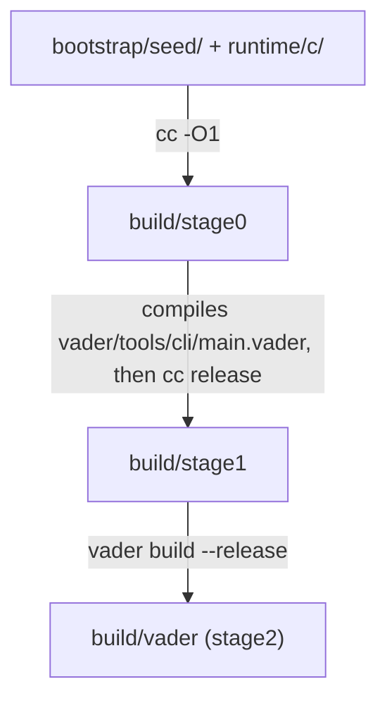

# Bootstrap

The compiler is written in Vader, so building it needs a compiler. A machine
with only a C compiler gets one from the **seed**: C committed under
`bootstrap/seed/`, which `cc` turns into a first compiler. This document
describes the seed, the three stages that lead from it to `build/vader`, the
check that the compiler reproduces itself, and when the seed is regenerated.

## The seed

The seed is the C of `vader/bootstrap/bootstrap.vader`, a compiler with a single
command:

```sh
bootstrap <input.vader> <output-prefix>
```

It compiles the input to one C unit per module, written beside the prefix. It
carries the whole pipeline but none of the front-ends: no command line, language
server, formatter or debugger. It must not import `vader/tools/`, so those
front-ends never change the seed. The VM is in it: the comptime engine needs it
for the `@comptime` declarations that loop, and `std/core` has some.

The tree's `bootstrap.vader` drives `vader/pipeline` the way
`vader build --release --emit=c` does; check (c) of the fixed point holds it to
that. The committed seed may come from an older version of the file.

The seed covers one target per operating system the C backend serves:
`darwin-arm64`, `linux-x86_64` and `windows-x86_64` (`SEED_TARGETS` in
`bootstrap/seed.sh`). They are emitted
together, against one atom table, so a unit that does not depend on the target
comes out byte for byte the same for all three and is stored once:

| Path | Holds |
|---|---|
| `bootstrap/seed/bootstrap-<module>.c` | a unit shared by every target |
| `bootstrap/seed/bootstrap.split.h` | the header every unit includes |
| `bootstrap/seed/<os>-<arch>/` | the units the targets disagree on (the globals among them), and `bootstrap.imports.h` |

Where a seed comes from is in git: `git log -1 -- bootstrap/seed` names the
commit that bumped it, and its parent is the tree the seed was emitted from.

`@target` selects by operating system, never by architecture, so one
architecture per OS is enough: a host without a seed of its own (Linux on arm64,
say) builds from the seed of its OS. Cross-compiling to another architecture
goes through `--target` and needs no seed. The WASM targets have no seed: nothing
can compile their output yet.

The C runtime is not part of the seed. `build.sh` links stage0 and stage1 with
the checkout's `runtime/c/`; stage1 finds the runtime and `lib/` for stage2 as any
compiler does, under `$VADER_HOME` first when it is set.

The seed is committed uncompressed, so that git can store each new seed as a
delta of the previous one ([ADR 0110](adr/0110-the-seed-is-committed-uncompressed.md)).
`.gitattributes` marks it `-diff -merge linguist-generated`: git never merges a
seed, and a conflict on it is resolved by regenerating it.

## From the seed to `build/vader`

```sh
bash bootstrap/build.sh            # seed → stage0 → stage1 → build/vader
bash bootstrap/build.sh --dist     # the same, then a bundle in dist/
```

`build.sh` uses `$CC` (`cc` by default) for every stage, resolving it to an
absolute path for stage1, and compiles the units of stage0 and stage1 in parallel
(`CC_JOBS`, the number of cores by default). On Windows, `bootstrap/build.ps1`
does the same with mingw-w64: `gcc` by default, `-CC clang` to change it, `-Dist`
for the bundle.



1. **stage0** is the seed compiled at `-O1` (`STAGE0_CFLAGS`): the shared units
   plus those of the host's target. Its only job is to build stage1.
2. **stage1** is the compiler of the tree, compiled by stage0: it behaves as the
   tree says, but its machine code comes from the seed's code generator, which
   may be older. It is built with the release flags and link-time optimisation
   that stage2 gets, because the fixed point compares what the two emit
   ([ADR 0004](adr/0004-bootstrap-stages-share-the-release-flags.md)).
   `build.sh` spells those flags out itself, since no compiler exists yet to ask:
   they must stay in step with `vader/pipeline/emit.vader`.
3. **stage2** is the tree compiled by stage1, `vader build --release`, and is
   the binary `build.sh` leaves in `build/vader`. Its code generator is the
   tree's own, so the age of the seed never reaches it.

`--dist` then assembles a bundle, `dist/vader-darwin-arm64/` or
`dist/vader-linux-x64/` for instance: the binary, `lib/`, the
compiler's sources under `src/vader/` (a project's `build.vader` is compiled
against them), `runtime/c/` and `third_party/`. The directories of `vader/` that
no build reaches (the human front-ends, the bootstrap entry) are left out; the
list is `bootstrap/dist-exclude.txt`. The binary looks for `lib/` and `runtime/c/`
next to itself, so the bundle runs from any directory.

## The fixed point

`bootstrap/verify.sh` runs `build.sh` (its arguments go there: `--dist`
also assembles the bundle), then checks:

- **(a)** stage2 compiles `main.vader` again, in release, and the C must be the
  C stage1 wrote for it, unit for unit (`diff -r`). stage1 and stage2 differ only
  by their code generator, the seed's against the tree's, so equality also shows
  that the seed's age did not leak into the compiler's behaviour.
- **(a2)** the same comparison on a small program without `--release`, which
  covers what only a debug build emits: `#line` directives and the per-op debug
  table.
- **(b)** stage1 builds stage2 a second time, to another path, and the two
  binaries must be byte-identical.
- **(c)** stage2 builds the tree's `vader/bootstrap/bootstrap.vader`, which must
  write for `main.vader` the C that (a) produced. Between two regenerations of
  the seed nothing else compiles that file.

It exits 0 when all of them hold, 1 when a comparison fails, and 2 when it could
not conclude (no C compiler, a structural `diff` error). A step that fails on the
way, a unit that does not compile or a stage that crashes, exits with that step's
own status.

A fixed point is not a proof of correctness: a compiler that miscompiles itself
the same way at every stage passes it. The test suite is the check of
correctness.

The CI runs `verify.sh --dist` on every push to `main` and every pull request:
it is the build step of its Linux job
([ADR 0006](adr/0006-the-fixed-point-gate-runs-on-every-push.md)). That build
runs before Bun or any package is set up, so it is also the check that a clone
with only a C compiler still builds. Each target builds the compiler once and
tests that build ([ADR 0115](adr/0115-the-ci-builds-each-target-once.md)).

## When to regenerate the seed

Only when it stops working: since the seed's age never reaches stage2, an old
seed costs nothing while stage0 compiles the tree and the fixed point holds.
Three kinds of change break it:

- a change an old stage0 cannot compile: a core type it looks up by name that
  moved, an intrinsic it does not know, a runtime function it calls that was
  removed or given another signature;
- a change to the contract between the build scripts and stage0: the scripts
  evolve with the tree but drive an older stage0, so the command line above and
  the names of the files it writes (`write_split_c`) are frozen between
  regenerations, and changing either needs a new seed before the change is
  pushed;
- a move of `lib/`: stage0 finds the standard library in its built-in places
  (`$VADER_HOME/lib`, `lib/` beside its binary, then `lib/` in the working
  directory), and reads no `vader.json`.

### Checking

```sh
bootstrap/seed.sh check [--quiet]
```

It answers whether the committed seed still bootstraps `HEAD`: it exports `HEAD`
into `build/seed.viability/` and runs `verify.sh` there, so neither an
uncommitted edit nor the checkout's `build/vader` takes part. It exits
0 when the seed is viable, 1 when it is broken, 2 when it cannot tell (no C
compiler, not a git checkout). A viable verdict is recorded in `build/seed.viable`
against the git objects of everything it read (the list is in `seed.sh`); while
none of them moves, `check` answers at once.

The pre-push hook `.githooks/pre-push` runs it when a push publishes `HEAD`. It
blocks the push on 1 and lets it through on 2, since the CI runs the same check
on `main` and on pull requests; `git push --no-verify` skips it. Enable it once
per clone:

```sh
git config core.hooksPath .githooks
```

### Regenerating

The seed is regenerated in a commit of its own, after the change that required
it. The new seed builds the stage0 that builds everything, so the suite runs
before the commit:

```sh
bootstrap/seed.sh regenerate
bun run build:cli && bun run test
git add bootstrap/seed
git commit -m 'chore(bootstrap): bump seed'
```

`regenerate` emits the seed with `$VADER`, else `./build/vader`, else the `vader`
on `PATH`, through `vader build --release --emit=c --seed-targets`, which writes
every target against one atom table (*The seed*, above), and:

- refuses to run when a tracked file under `vader/`, `lib/` or `runtime/c/` has
  uncommitted changes, since a seed must be the emission of a commit, standard
  library included (a new file not yet added escapes the check);
- first builds the tree with that binary, into `build/vader`, when a `.vader`
  source is newer than the binary, so that the seed carries the tree's code
  generator. This is also the way out when the committed seed no longer
  bootstraps: `build.sh` cannot produce a compiler then, but the last
  `build/vader` usually still compiles the tree;
- leaves the seed alone when the new seed is byte-identical to the
  committed one;
- refuses to write a seed that contains a NUL byte, the mark of a string
  collected while still in use ([ADR 0005](adr/0005-the-seed-refuses-nul-bytes.md)).
