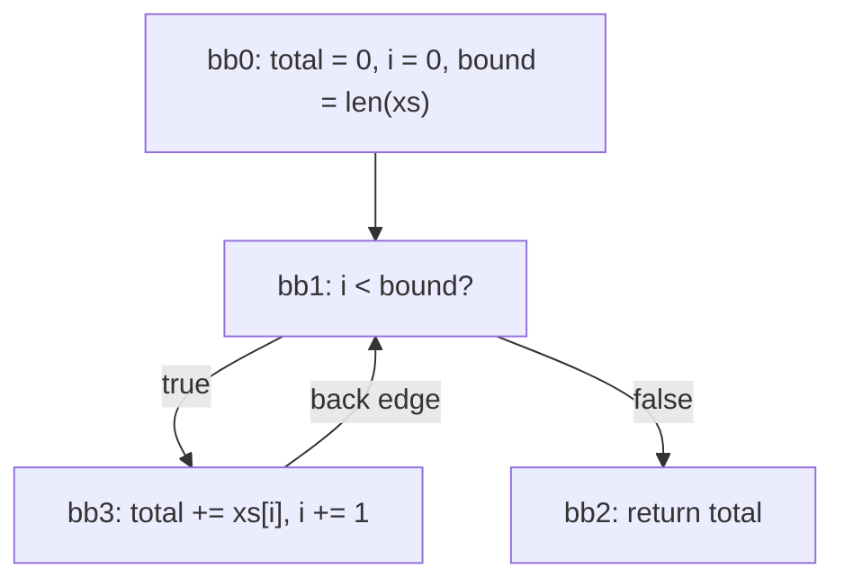

# Mid-IR

The Mid-IR is the compiler's control-flow graph (CFG) form of a program. It sits
between the lowered AST and the bytecode. Each function becomes a graph of basic
blocks over typed, numbered locals.

This document describes the Mid-IR as a language. The passes that run on it are
listed in [`ARCHITECTURE.md`](ARCHITECTURE.md).

## Model

**Program.** A program is a set of modules. Each module holds functions with a body,
bodiless functions (`@extern` and `@intrinsic`, provided by the host or a C library),
and struct declarations. The program also has:

- a string pool: each string literal is stored once, and a `const` refers to it by
  index;
- a data pool: constant arrays, built before the program runs. A constant struct is
  stored as an array of one element;
- global slots: storage that outlives every call, used for `@singleton`;
- the vtables: for each type, the function serving each trait method.

**Function.** A function has parameters, a return type, a table of locals and a list
of blocks. Execution starts at block `bb0`.

**Locals.** Every value lives in a local, numbered `%0`, `%1`... The parameters are
the first locals. A local has a type and may be written any number of times: the
Mid-IR is not in SSA form.

**Types.** Each local has a Vader type. Types are concrete: no type parameter is left.
One gap remains: the lowerer gives no type to a cell (a heap box shared with a
closure) or to the closure of a `defer`, and the dump shows them as `?`.
A generic instance may erase a reference type argument to `Any`, a pointer to any
object. A value of a range type is held in the narrowest integer that holds its
range: an `Hour :: Int in 0..=23` is a `u8`
([ADR 0097](adr/0097-the-cfg-decides-the-integer-a-value-is-held-in.md)).

**Blocks.** A block is a list of instructions followed by one terminator. Control
enters at the first instruction and leaves through the terminator, the only place that
names other blocks.

**Spans.** Every instruction and terminator carries the position of the source code
it comes from.

## Notation

This document uses the text form of `vader dump --stage=cfg <file>`:

```
fn main$max(%0: i32, %1: i32) -> i32
  locals:
    %0 a: i32 (param a)
    %1 b: i32 (param b)
    %2 if_res: i32
    %3 $gt_3: bool
  bb0:
    %3 = binop 16 %0 %1 :bool
    cond_branch %3 ? bb1 : bb3
  ...
```

This is the start of `max`, shown in full in *`if` as a value*.

- A function starts with its mangled name and signature, then lists its locals.
- A local shows its name and type. A local the program declares is marked `param`,
  `local`, `binding` (bound by a pattern) or `synthetic` (introduced by the lowerer).
  A temporary has no mark and is named after what produced it: `$gt_3` holds a
  comparison.
- `:T` after an instruction gives the type of its result.
- A `call` prints its callee's symbol name: the source name for most functions
  (`call twice`), a mangled name for a generic instance (`std_io$println__string`).
- `binop` and `unop` print their operator as a number (*Arithmetic*).
- The dump omits spans. It cannot be read back.

## Instructions

Each instruction reads locals and writes its result to a destination local, written on
the left of `=`. An instruction that produces nothing has no destination.

### Values

```
%d = const <value> :T
```

Writes a constant: `int(n)`, `float(x)`, `bool(b)`, `char(c)` (a code point),
`string(#n)` (entry `n` of the string pool) or `null`.

```
%d = move %s
```

Copies `%s` into `%d`.

```
%d = cast %s :T
```

Holds the value of `%s` as type `T`. It converts a number to another numeric type,
tags a scalar that enters a union or another boxed slot
([ADR 0098](adr/0098-a-scalar-entering-any-boxed-slot-is-tagged-by-its-type.md)), or
narrows a union to the variant a `type_check` has established.

```
%d = data_const <n> :T
```

Reads entry `n` of the data pool (*Model*).

```
%d = type_const T
```

Makes the type `T` a value.

### Arithmetic

```
%d = binop <op> %a %b :T
%d = unop <op> %a :T
```

Applies an operator. `T` is the type the operation is computed in. The operators, with
the number the dump prints:

| # | Operator | Meaning |
|---|---|---|
| 0, 1, 2 | `add`, `sub`, `mul` | integer arithmetic that wraps on overflow; float arithmetic |
| 3 | `div` | division, rounded toward zero on integers; an integer division by zero stops the program |
| 4 | `mod` | integer remainder, with the sign of the left operand; a `mod` by zero stops the program |
| 5, 6 | `shl`, `shr` | shifts; `shr` copies the sign bit of a signed integer, and fills with zeros otherwise |
| 7, 8, 9 | `bitand`, `bitor`, `bitxor` | bitwise operations |
| 10, 11 | `and`, `or` | never produced: `&&` and `||` become branches |
| 12, 13 | `eq`, `neq` | equality: a scalar or a string by value, an object by reference |
| 14 to 17 | `lt`, `lte`, `gt`, `gte` | comparisons, signed or unsigned depending on the type |
| 18, 19, 20 | `add_checked`, `sub_checked`, `mul_checked` | integer arithmetic that stops the program on overflow, except in a release native build, where it wraps; float arithmetic |

| # | Operator | Meaning |
|---|---|---|
| 0 | `neg` | negation; on an integer, checked like `sub_checked` |
| 1 | `not` | logical negation |
| 2 | `bitnot` | bitwise complement |

A Vader `==` that needs an `Equals` implementation, on a struct for instance, arrives
as a `call` to it, or as a `vcall` when the type is known only at run time. The exact
run-time behaviour of each operation is in the bytecode reference,
[`vader/front/virt/ops.md`](../vader/front/virt/ops.md).

### Calls

```
%d = call f(%a, %b) :T
%d1, %d2 = call f(%a) :T
call f(%a) :void
```

Calls the function or bodiless function `f` with the arguments in order. A function
rewritten to return the elements of a small tuple, or the tag and fields of an
`S | null`, hands back several values, one per destination.

```
%d = call_indirect %f(%a, %b) :T
```

Calls the function value held in `%f`.

```
%d = vcall Trait.method(recv=%r, %a) :T
```

Calls the implementation of `Trait.method` for the run-time type of `%r`, found in
that type's vtable. `%r` is passed as the first argument.

```
%d = intrinsic name(%a)
```

Runs an operation of the compiler or the runtime that has no call form in Vader, such
as `size_of.type` behind `@size_of(T)`.

### Function values

```
%d = fn_ref f :T
%d = make_closure f env=%e :T
```

`fn_ref` makes a function value from `f`. `make_closure` makes a function value whose
environment is `%e`, a struct holding the captured values. Calling the value calls
`f` with the environment as first argument.

```
%d = fn_addr f :T
```

Takes the address of `f`, to hand to a C function as a callback. It appears only as an
argument of a call to an `@extern` function. The VM cannot run it.

### Structs and unions

```
%d = struct_new S(%a, %b)
```

Allocates a struct of type `S`, its fields initialised in declaration order. Escape
analysis marks a struct that cannot outlive its function, written `struct_new[stack]`.

```
%d = field_get %s.f :T
field_set %s.f = %v
```

Reads or writes field `f` of the struct in `%s`.

```
%d = union_field_get %u.f :T
union_field_set %u.f = %v
```

Reads or writes field `f` of `%u`, a union of structs that all have a field `f` at
the same place. The value may be any variant.

### Arrays

```
%d = array_new T[][n](%a, %b)
```

Allocates an array of `n` elements of type `T`, initialised in order.

```
%d = array_get %a[%i] :T
array_set %a[%i] = %v
```

Reads or writes element `%i` of `%a`. An index outside the array stops the program.

```
%d = array_len %a
```

Writes the length of `%a`, an `i64`.

```
array_push %a, %v
```

Appends `%v` to `%a`.

```
%d = array_slice %a[%lo..%hi] :T
```

Writes a view of the elements `%lo` to `%hi`, excluded, of `%a`, sharing its
elements. A bound outside the array is clamped to it.

### Type tests

```
%d = type_check %v is T
```

Writes whether the run-time type of `%v` is `T`. A union `T` matches any of its
variants.

### Closure cells

```
%d = cell_new %v :T
%d = cell_get %c :T
cell_set %c = %v :T
```

A cell is a heap box holding one value. A local that a closure captures and that is
reassigned lives in a cell, which the function and the closure share. A captured
local that is never reassigned is copied into the closure instead
([ADR 0030](adr/0030-a-capture-nothing-rebinds-is-copied-into-the-closure.md)).

### Globals

```
%d = global_get <n> :T
global_set <n> = %v :T
```

Reads or writes global slot `n`. A slot starts at its type's zero value.

### Defer

```
defer.push %c
defer.pop_exec <n>
```

`defer.push` registers the function value `%c` on the frame's defer stack.
`defer.pop_exec` removes the last `n` registered and runs them, most recent first.

## Terminators

```
branch -> bbN
cond_branch %c ? bbT : bbF
return
return %v
return %a, %b
unreachable ; <reason>
```

- `branch` jumps to `bbN`.
- `cond_branch` jumps to `bbT` when the `bool` in `%c` is true, to `bbF` otherwise.
- `return` returns zero, one or several values (*Calls*).
- `unreachable` stops the program with `<reason>`. It ends a path the type checker
  rules out, such as the end of an exhaustive `match` or the code after a call to a
  `@no_return` function. It also ends a path that fails at run time, such as a
  conversion that falls outside a range type.

There is no multi-way branch: a `match` becomes a chain of `cond_branch`.

## Rules

A well-formed function follows these rules. A block may be unreachable; rules 2 to 7
apply to the reachable blocks.

1. Execution starts at `bb0`. The block at index `n` is `bbN`, and every terminator
   names an existing block.
2. Every local is declared in the function's table.
3. A local is written before it is read. Parameters are written on entry.
4. Every callee is a function or a bodiless function of the program. A function value
   (`fn_ref`, `fn_addr`, `make_closure`) names a function with a body.
5. Every `return` carries as many values as the function returns. An empty `return`
   may end a path the program never takes: the lowerer adds one after paths that have
   all returned.
6. An integer enters a slot held in another integer type only through a `cast`. An
   operation's integer operands and result share one type
   ([ADR 0097](adr/0097-the-cfg-decides-the-integer-a-value-is-held-in.md)).
7. The graph is reducible: a loop is entered only through its first block, its header.

`vader build --verify` checks these rules after every pass, with two limits. For rule
3 it only asks for one write somewhere in the function. It does not check rule 7; the
bytecode emitter stops on a graph that breaks it.

## From Vader to the Mid-IR

The listings below are real output of `vader dump --stage=cfg`, which shows the CFG
before any pass runs. The passes fold most of the `const` and `move` pairs.

### `if` as a value

```vader
max :: fn(a: i32, b: i32) -> i32 = if a > b { a } else { b }
```

```
fn main$max(%0: i32, %1: i32) -> i32
  locals:
    %0 a: i32 (param a)
    %1 b: i32 (param b)
    %2 if_res: i32
    %3 $gt_3: bool
  bb0:
    %3 = binop 16 %0 %1 :bool
    cond_branch %3 ? bb1 : bb3
  bb1:
    %2 = move %0
    branch -> bb2
  bb2:
    return %2
  bb3:
    %2 = move %1
    branch -> bb2
```

The two arms write the result to the same local, `if_res`, and meet at `bb2`. `16` is
`gt`.

### Loops

```vader
sum :: fn(xs: i32[]) -> i32 {
    total := 0
    for i in 0..<xs.len() {
        total += xs[i]
    }
    return total
}
```

```
fn main$sum(%0: i32[]) -> i32
  locals:
    %0 xs: i32[] (param xs)
    %1 $k_1: i32
    %2 total: i32 (local total)
    %3 $k_3: i64
    %4 i: i64 (local i)
    %5 $len_5: i64
    %6 __for_hi_0: i64 (synthetic __for_hi_0)
    %7 $lt_7: bool
    %8 $idx_8: i32
    %9 $add_checked_9: i32
    %10 $k_10: i64
    %11 $add_11: i64
  bb0:
    %1 = const int(0) :i32
    %2 = move %1
    %3 = const int(0) :i64
    %4 = move %3
    %5 = array_len %0
    %6 = move %5
    branch -> bb1
  bb1:
    %7 = binop 14 %4 %6 :bool
    cond_branch %7 ? bb3 : bb2
  bb2:
    return %2
  bb3:
    %8 = array_get %0[%4] :i32
    %9 = binop 18 %2 %8 :i32
    %2 = move %9
    %10 = const int(1) :i64
    %11 = binop 0 %4 %10 :i64
    %4 = move %11
    branch -> bb1
```



- `bb1` is the loop header: it compares `i` with the bound (`14` is `lt`). The bound
  is read once, before the loop.
- `bb3` is the body. `total += xs[i]` is a checked addition (`18`). The step `i + 1`,
  added by the lowerer, wraps (`0`). The body ends with a branch back to the header.
- `bb2` is the exit.

`break` jumps to the exit, and `continue` runs the step and jumps to the header. In
this loop over the elements of `xs`:

```vader
count_positive :: fn(xs: i32[]) -> i32 {
    n := 0
    for x in xs {
        if x == 0 {
            break
        }
        if x < 0 {
            continue
        }
        n += 1
    }
    return n
}
```

the blocks after the header are (excerpt):

```
  bb2:
    return %2
  bb3:
    %9 = array_get %3[%7] :i32
    %10 = move %9
    %11 = const int(0) :i32
    %12 = binop 12 %10 %11 :bool
    cond_branch %12 ? bb4 : bb5
  bb4:
    branch -> bb2
  bb5:
    %13 = const int(0) :i32
    %14 = binop 14 %10 %13 :bool
    cond_branch %14 ? bb6 : bb7
  bb6:
    %15 = const int(1) :i64
    %16 = binop 0 %7 %15 :i64
    %7 = move %16
    branch -> bb1
  bb7:
    %17 = const int(1) :i32
    %18 = binop 18 %2 %17 :i32
    %2 = move %18
    %19 = const int(1) :i64
    %20 = binop 0 %7 %19 :i64
    %7 = move %20
    branch -> bb1
```

The loop runs on a hidden index, `%7` (`__for_i_2`); `%10` is `x` and `%2` is `n`.
`12` is `eq`. `bb4` is the `break`. `bb6` is the `continue`: it carries its own copy
of the step `%7 + 1`. `bb7` is the normal end of the body.

### `&&` and `||` in a condition

```vader
digit :: fn(x: i32) -> i32 {
    if x < 0 || x > 9 {
        return 0
    }
    return x
}
```

```
fn main$digit(%0: i32) -> i32
  locals:
    %0 x: i32 (param x)
    %1 $k_1: i32
    %2 $lt_2: bool
    %3 $k_3: i32
    %4 $gt_4: bool
    %5 $k_5: i32
  bb0:
    %1 = const int(0) :i32
    %2 = binop 14 %0 %1 :bool
    cond_branch %2 ? bb1 : bb3
  bb1:
    %5 = const int(0) :i32
    return %5
  bb2:
    return %0
  bb3:
    %3 = const int(9) :i32
    %4 = binop 16 %0 %3 :bool
    cond_branch %4 ? bb1 : bb2
```

Each operand gets its own `cond_branch`. When `x < 0` holds, control goes straight to
the `return 0` in `bb1`, and `x > 9` is never computed. In some shapes the result
goes into a local instead, tested once
([ADR 0028](adr/0028-a-condition-branches-on-each-operand-where-c-needs-no-goto.md)).

### `match` on a union

```vader
Shape :: Circle | Square

area :: fn(s: Shape) -> f64 = match s {
    is Circle -> 3.0 * s.radius * s.radius
    is Square -> s.side * s.side
}
```

With the locals omitted:

```
fn main$area(%0: Circle | Square) -> f64
  locals:
    ...
  bb0:
    %2 = type_check %0 is Circle
    cond_branch %2 ? bb1 : bb3
  bb1:
    %3 = const float(3.0) :f64
    %4 = cast %0 :Circle
    %5 = field_get %4.radius :f64
    %6 = binop 20 %3 %5 :f64
    %7 = cast %0 :Circle
    %8 = field_get %7.radius :f64
    %9 = binop 20 %6 %8 :f64
    %1 = move %9
    branch -> bb2
  bb2:
    return %1
  bb3:
    %10 = type_check %0 is Square
    cond_branch %10 ? bb4 : bb6
  bb4:
    %11 = cast %0 :Square
    %12 = field_get %11.side :f64
    %13 = cast %0 :Square
    %14 = field_get %13.side :f64
    %15 = binop 20 %12 %14 :f64
    %1 = move %15
    branch -> bb5
  bb5:
    branch -> bb2
  bb6:
    unreachable ; non-exhaustive match (T3013 should have caught this)
```

- Each arm is a `type_check` followed by a `cond_branch`, in the order of the arms.
- In an arm, each read of `s` is a `cast` to the variant, then a `field_get`.
- `20` is `mul_checked`, which on `f64` is a plain multiplication.
- The `match` is exhaustive, so the path that matches no arm ends in `unreachable`.
- `bb5` is the empty join of the second test's arms. It only forwards to `bb2`.

### Structs

```vader
sum_point :: fn(a: i32, b: i32) -> i32 {
    p :: Point { .x = a, .y = b }
    return p.x + p.y
}
```

```
fn main$sum_point(%0: i32, %1: i32) -> i32
  locals:
    %0 a: i32 (param a)
    %1 b: i32 (param b)
    %2 $struct_2: Point
    %3 p: Point (local p)
    %4 $field_4: i32
    %5 $field_5: i32
    %6 $add_checked_6: i32
  bb0:
    %2 = struct_new Point(%0, %1)
    %3 = move %2
    %4 = field_get %3.x :i32
    %5 = field_get %3.y :i32
    %6 = binop 18 %4 %5 :i32
    return %6
```

`p` never leaves the function. This listing comes before escape analysis, which then
marks the `struct_new` with the `stack` flag; a native build places `p` on the stack.

### Trait calls

```vader
Named :: trait {
    name :: fn(self) -> string
}

greet :: fn(n: Named) -> string = n.name()
```

```
fn main$greet(%0: Named) -> string
  locals:
    %0 n: Named (param n)
    %1 $vcall_1: string
  bb0:
    %1 = vcall main$Named.name(recv=%0) :string
    return %1
```

`n` can hold any type that implements `Named`, so the call goes through the vtable
of its run-time type. On a value of known type, the lowerer calls the implementation
directly.

### Closures

A lambda becomes a function of its own, whose first parameter is its environment: a
struct of the captured values. The captured `step` is never reassigned, so the
environment holds a copy of it:

```vader
twice :: fn(f: fn(i32) -> i32, x: i32) -> i32 = f(f(x))

add_step :: fn(step: i32) -> i32 {
    return twice((x: i32) -> x + step, 1)
}
```

```
fn main$twice(%0: fn(i32) -> i32, %1: i32) -> i32
  locals:
    %0 f: fn(i32) -> i32 (param f)
    %1 x: i32 (param x)
    %2 $call_ind_2: i32
    %3 $call_ind_3: i32
  bb0:
    %2 = call_indirect %0(%1) :i32
    %3 = call_indirect %0(%2) :i32
    return %3

fn main$add_step(%0: i32) -> i32
  locals:
    %0 step: i32 (param step)
    %1 $struct_1: __lambda_env_main_1
    %2 $closure_2: fn(i32) -> i32
    %3 $k_3: i32
    %4 $call_4: i32
  bb0:
    %1 = struct_new __lambda_env_main_1(%0)
    %2 = make_closure __lambda_main_0 env=%1 :fn(i32) -> i32
    %3 = const int(1) :i32
    %4 = call twice(%2, %3) :i32
    return %4

fn __lambda_main_0(%0: __lambda_env_main_1, %1: i32) -> i32
  locals:
    %0 __env_0: __lambda_env_main_1 (synthetic __env_0)
    %1 x: i32 (param x)
    %2 $field_2: i32
    %3 $add_checked_3: i32
  bb0:
    %2 = field_get %0.cap_0 :i32
    %3 = binop 18 %1 %2 :i32
    return %3
```

A captured local that is reassigned lives in a cell (*Closure cells*):

```vader
counter :: fn() -> i32 {
    n := 0
    bump :: () -> { n += 1 }
    bump()
    bump()
    return n
}
```

```
fn main$counter() -> i32
  locals:
    %0 $k_0: i32
    %1 $cell_1: ?
    %2 n: ? (local n)
    %3 $struct_3: __lambda_env_main_1
    %4 bump: __lambda_env_main_1 (local bump)
    %5 $cell_get_5: i32
  bb0:
    %0 = const int(0) :i32
    %1 = cell_new %0 :i32
    %2 = move %1
    %3 = struct_new __lambda_env_main_1(%2)
    %4 = move %3
    call __lambda_main_0(%4) :void
    call __lambda_main_0(%4) :void
    %5 = cell_get %2 :i32
    return %5

fn __lambda_main_0(%0: __lambda_env_main_1) -> void
  locals:
    %0 __env_0: __lambda_env_main_1 (synthetic __env_0)
    %1 $field_1: ?
    %2 $field_2: ?
    %3 $cell_get_3: i32
    %4 $k_4: i32
    %5 $add_checked_5: i32
  bb0:
    %1 = field_get %0.cap_0 :?
    %2 = field_get %0.cap_0 :?
    %3 = cell_get %2 :i32
    %4 = const int(1) :i32
    %5 = binop 18 %3 %4 :i32
    cell_set %1 = %5 :i32
    return
```

`bump` is bound once and only called, so its calls name the lambda directly and pass
the environment, with no `make_closure`. The cell's type shows as `?` (*Model*).

A lambda that captures nothing has no environment parameter. It is an ordinary
function, taken as a value with `fn_ref`.

### `defer`

```vader
with_defer :: fn() -> void {
    defer println("done")
    println("work")
}
```

```
fn main$with_defer() -> void
  locals:
    %0 $struct_0: __defer_env_main_3
    %1 $closure_1: ?
    %2 $k_2: string
  bb0:
    %0 = struct_new __defer_env_main_3()
    %1 = make_closure __defer_main_2 env=%0 :?
    defer.push %1
    %2 = const string(#1) :string
    call std_io$println__string(%2) :void
    defer.pop_exec 1
    return
```

The deferred statement becomes a function, `__defer_main_2`, wrapped in a closure and
registered by `defer.push`. Each exit of the scope runs it with `defer.pop_exec`.
